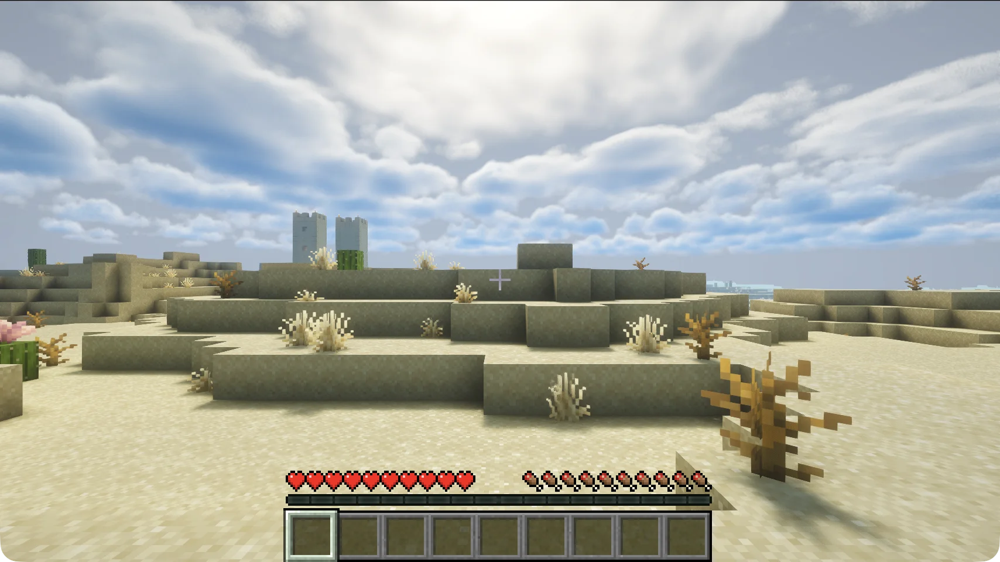
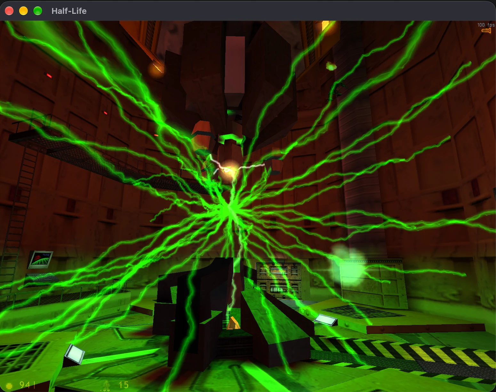

<p align="center">
  
</p>

<h3 align="center">OpenGL 4.6 on Apple silicon, running on Metal</h3>

<p align="center">
  <a href="https://github.com/BryanHaley/MooGL/releases/latest"></a>
  
  
  <a href="LICENSE"></a>
</p>

OpenGL has been deprecated for years on macOS, and was never updated past 4.1. MooGL is a complete OpenGL 4.6 Core implementation (along with the most important legacy features) written on top of Metal, so most OpenGL code (compute shaders, direct state access, SPIR-V, bindless textures, mesh shaders) builds and runs on a Mac. You link it like any other library and open a window with the GLFW, SDL2, SDL3, SFML or raylib it ships with.

It also ships AMD FSR 2's API on top of Apple's MetalFX upscaler so a game that uses FSR 2 on Windows/Linux can be ported to Mac without touching its FSR 2 code.

## Where it stands

| Suite | Passed | Failed |
| --- | ---: | ---: |
| Khronos KHR-GL46 (the OpenGL 4.6 conformance tests) | 17,987 | **0** |
| Khronos KHR-Single | 8,836 | **0** |
| Khronos `texture_swizzle` | 505 | **0** |
| MooGL's own suite | 1,516 | **0** |

The 1,728 KHR-GL46 cases MooGL does not run are ones the conformance suite lets a driver decline (mostly optional extensions). These are local runs; MooGL has not been submitted to Khronos and is not an officially conformant product.

## IDKEngine on MooGL

<p align="center">
  
</p>

[IDKEngine](https://github.com/BoyBaykiller/IDKEngine) has an OpenGL 4.6 renderer written for NVIDIA hardware on Windows. Here it runs through MooGL on an M1 Max MacBook Pro, drawing 1600×900 pixels at about ~50 fps. The frame shows:

- **Sponza, Lucy and the damaged helmet**, about 290,000 triangles, drawn with multi-draw-indirect: one draw call for the whole scene.
- **Bindless textures**: every material reads its textures through handles stored in buffers, not through texture units.
- **Coloured point lights with soft shadows**, each light's cube map rendered in one pass by writing `gl_Layer` from the vertex shader (`ARB_shader_viewport_layer_array`).
- **SSAO, volumetric light and bloom**, all compute shaders, then tone mapping.
- **FSR 2 upscaling** from half resolution, through MooGL's FSR 2 on MetalFX.
- The engine's **ImGui** interface, drawn through the same GL context. At the top right it reports `MGL` as the renderer and a resolution scale of 0.5.

MooGL's build of the engine also turns on its subgroup, SPIR-V, debug-output and mesh shader paths, which stock macOS can't run, and its path tracer works too.

## Minecraft on MooGL

Some shaderpacks need OpenGL >4.1 and won't run on Apple's OpenGL implementation, or disable some features on macOS; they should work on MooGL.

### Iris Shaderpacks on 26.3

<p align="center">
  
</p>

Shown above is Minecraft 26.3 with Fabric, Sodium, and Iris running the BetterVoxels shaderpack (you'll likely need an ~M3 Max or better to get a decent framerate with this shaderpack though; try something like the Complementary Unbound shaderpack for a better framerate).

1. Download and extract the MooGL SDK anywhere; in this example we use: `/opt/MooGL-SDK`
2. Install Iris with its installer, as usual. It adds an Iris profile to the launcher.
3. Put the shaderpack in `~/Library/Application Support/minecraft/shaderpacks`.
4. In the launcher, open **Installations**, edit the Iris profile, open **More options**, and add this to the end of **JVM arguments**, with the path to your SDK:

   ```
   -Dorg.lwjgl.sdl.libname=/opt/MooGL-SDK/lib/libSDL3.0.dylib -Dorg.lwjgl.opengl.libname=/opt/MooGL-SDK/lib/libmoogl.dylib
   ```

5. Start the game and choose the shaderpack under **Options > Video Settings > Shader Packs**. The game log says `using drivers: 4.6.0 MooGL`.

### Vanilla Minecraft

Vanilla Minecraft benefits from MooGL as well; on M1 Max on a scene similar to the screenshot rendered at ~380 FPS on Apple's OpenGL and ~1,400 FPS on MooGL.

1. In the Minecraft launcher, open **Installations** and edit the installation you play, such as **Latest release** (or your Iris profile).
2. Open **More options**, then add this to the end of **JVM arguments**:

    ```
    -Dorg.lwjgl.sdl.libname=/opt/MooGL-SDK/lib/libSDL3.0.dylib -Dorg.lwjgl.opengl.libname=/opt/MooGL-SDK/lib/libmoogl.dylib
    ```

3. Start the game. The log should say `using drivers: 4.6.0 MooGL`, and the F3 screen shows MooGL as the renderer.

Minecraft 26.3 opens its window with SDL3. Older versions down to 1.19 use GLFW: point `-Dorg.lwjgl.glfw.libname` at the SDK's `libglfw.dylib` instead of SDL3.

```
-Dorg.lwjgl.glfw.libname=/opt/MooGL-SDK/lib/libglfw.dylib -Dorg.lwjgl.opengl.libname=/opt/MooGL-SDK/lib/libmoogl.dylib
```

`libglfw.dylib` or `libSDL3.0.dylib` and `libmoogl.dylib` must be in the same folder.

For versions lower than 1.19, see the DawnCraft section.

### DawnCraft (Minecraft 1.18.2, Forge)

DawnCraft doesn't work on macOS with Apple OpenGL; it closes with "Requested OpenGL version 4.3, got version 4.1." With MooGL it works.

Minecraft 1.18.2 opens its window with GLFW, not SDL3. Its stock libraries also lack Apple silicon builds of LWJGL and java-objc-bridge. Prism Launcher fixes both when it sets up the instance, so use Prism rather than the Mojang launcher.

1. Install Prism Launcher and sign in with your Microsoft account.
2. Add DawnCraft: **Add Instance → CurseForge**, search "DawnCraft", and pick the latest version (2.0.16_hf). Prism installs Forge 40.2.17 and the 305 mods.
3. Open the instance's **Settings**:
    - **Java**: use Java 17 for Apple silicon (Prism can download it), and set maximum memory to 8 GB.
    - **Java arguments**: add
      ```
      -Dorg.lwjgl.glfw.libname=/opt/MooGL-SDK/lib/libglfw.dylib -Dorg.lwjgl.opengl.libname=/opt/MooGL-SDK/lib/libmoogl.dylib
      ```
4. Launch. The log line `GPU: MGL (Supports OpenGL 4.6.0 MooGL ...)` confirms MooGL is in use.

On M1 Max I observed ~250 FPS in DawnCraft.

## Legacy OpenGL

<p align="center">
  
</p>

MooGL also supports the vast majority of legacy OpenGL applications. A program that asks for the compatibility profile, or for no profile at all as old code does, gets a 4.6 context that supports the majority of compatibility features. Here is [Xash3D FWGS](https://github.com/FWGS/xash3d-fwgs), whose renderer is written for OpenGL 1.x, on an M1 Max MacBook Pro. It uses:

- **`glBegin` and `glEnd`** for the world, models and HUD, and **client-side vertex arrays** for the models.
- **The matrix stacks** and **`glTexEnv`** for texturing and lightmaps.
- **The alpha test** for see-through textures such as grates and railings, and **blending** for the green beams and sprites.

See [Known limits](#known-limits) for what the compatibility profile covers. Old Mac code works too:

- **GLUT**, as `libglut`: freeglut with a MooGL backend, from `<GLUT/glut.h>` or `<GL/freeglut.h>`.
- **GLU**, as `libGLU`: Mesa's GLU, NURBS and tessellator included. Mac code keeps including `<OpenGL/glu.h>` and links `libGLU` instead of `OpenGL.framework`.
- **`<GL/gl.h>` and `<GL/glext.h>`** for code from other systems: Apple's `gl.h` up to GL 2.1, and Khronos's `glext.h` for the rest, with `GL_GLEXT_PROTOTYPES` declaring the calls as on Linux.
- **CGL and AGL**: `CGLChoosePixelFormat`, `CGLCreateContext`, `aglCreateContext` and the rest make MooGL contexts in a program linked to `libmoogl` instead of `OpenGL.framework`. AGL left the SDK in macOS 10.14, so MooGL ships its own `<AGL/agl.h>`.
- **Apple's extensions**: `GL_APPLE_client_storage`, `GL_APPLE_texture_range`, `GL_APPLE_ycbcr_422`, `GL_APPLE_packed_pixels` and `GL_EXT_texture_rectangle`.
- **`SDL_Renderer`'s `opengl` backend**, and any texture border colour, exact even with linear filtering.
- **SFML 3 and 2.6**: the graphics module, `sf::Shader` and text included, draws through a compatibility context.

## Get the SDK

Download `MooGL-SDK-<version>-macos-arm64.tar.gz` from the [releases page](https://github.com/BryanHaley/MooGL/releases) and unpack it anywhere.

```
MooGL-SDK/
  lib/        libmoogl.dylib (OpenGL)
              libglfw.dylib  libSDL2-2.0.0.dylib  libSDL3.0.dylib  libglut.3.dylib
              libsfml-*.3.1.dylib  libraylib.620.dylib (GLFW, SDL, GLUT, SFML 3 and raylib for MooGL)
              libGLU.1.dylib (GLU)
              libimgui.a (Dear ImGui, drawing with MooGL)
              libffx_fsr2_api.dylib (FSR 2 on MetalFX)
              cmake/MooGL/  cmake/SDL2/  cmake/SDL3/  cmake/SFML/  cmake/raylib/  cmake/glfw3/
  include/    GL/glcorearb.h  GL/gl.h  GL/glext.h  GL/glu.h  GL/freeglut.h  GLUT/glut.h  AGL/agl.h
              GLES2/  GLES3/  KHR/khrplatform.h
              GLFW/  SDL2/  SDL3/  SFML/  raylib.h  raymath.h  rlgl.h  rcamera.h  imgui/  MGLContext.h  ffx-fsr2/
  sfml2/      SFML 2.6, with its own include/, lib/ and CMake package
  examples/   triangle/ (GLFW)  sdl2_triangle/ sdl3_triangle/ (SDL)  glut_teapot/ (GLUT)
              sfml_shapes/ (SFML 3)  raylib_shapes/ (raylib)  imgui/ imgui_sdl2/ (Dear ImGui)
  nuget/      FFX_FSR2 for C# on macOS
  licenses/
```

The libraries are signed and notarized, so macOS loads them straight from the download.

You need an Apple silicon Mac on macOS 13 or later, plus Xcode or the Command Line Tools (`xcode-select --install`). MooGL is tested on macOS 27.

## Build your first program

The SDK's example draws a spinning triangle. With CMake:

```bash
cd MooGL-SDK-*/examples/triangle
cmake -B build -DCMAKE_PREFIX_PATH="$PWD/../.."
cmake --build build
./build/triangle
```

Or with nothing but clang:

```bash
SDK=/opt/MooGL-SDK
clang main.c -o triangle -I"$SDK/include" -L"$SDK/lib" -lglfw -lmoogl -Wl,-rpath,"$SDK/lib"
```

In your own CMake project:

```cmake
find_package(MooGL REQUIRED)                        # with -DCMAKE_PREFIX_PATH=/opt/MooGL-SDK
target_link_libraries(my_app PRIVATE MooGL::glfw)   # GLFW and OpenGL
```

`MooGL::GL` is the GL library alone and `MooGL::FSR2` is FSR 2. `MooGL_LIBRARY_DIR` holds the folder with the dylibs.

`MooGL::imgui` is [Dear ImGui](https://github.com/ocornut/imgui) (docking branch) with its GLFW, SDL2 and OpenGL 3 backends. Stock ImGui's OpenGL backend loads Apple's OpenGL on a Mac; this one draws with MooGL. Link it with `MooGL::glfw` or `SDL2::SDL2`. Its examples, one for GLFW and one for SDL2, open ImGui's demo with docking and multi-viewports, so windows dragged out of the main one get their own shared-context window.

## Writing OpenGL 4.6 on a Mac

Everything below is ordinary OpenGL. These are the few places where a Mac or MooGL needs something specific.

### 1. Open a window with GLFW, SDL, SFML or raylib

Use the GLFW, SDL, SFML or raylib from the SDK, not one from Homebrew: they are GLFW 3.4, SDL 2.32 and 3.4, SFML 3.1 and 2.6, and raylib 6.2, built to make MooGL contexts instead of Apple's. Any version request up to 4.6 gets 4.6, so code that asks for 3.3 or 4.1 core, as most Mac code does, works unchanged. Asking for the core profile gets a core context. Asking for the compatibility profile, or for no profile at all as old code does, gets a compatibility context, which also has what the core profile removed: `glBegin`, the matrix stacks, fixed-function lighting and texturing, display lists and the rest (see [Known limits](#known-limits)). With GLFW:

```c
#include <GL/glcorearb.h>
#define GLFW_INCLUDE_NONE
#include <GLFW/glfw3.h>

glfwInit();
glfwWindowHint(GLFW_CONTEXT_VERSION_MAJOR, 4);
glfwWindowHint(GLFW_CONTEXT_VERSION_MINOR, 6);
glfwWindowHint(GLFW_OPENGL_PROFILE, GLFW_OPENGL_CORE_PROFILE);
GLFWwindow *window = glfwCreateWindow(1280, 720, "My app", NULL, NULL);
glfwMakeContextCurrent(window);
```

`GLFW_OPENGL_DEBUG_CONTEXT` and `GLFW_CONTEXT_NO_ERROR` work as usual. With SDL2:

```c
#include <GL/glcorearb.h>
#include <SDL2/SDL.h>

SDL_Init(SDL_INIT_VIDEO);
SDL_GL_SetAttribute(SDL_GL_CONTEXT_MAJOR_VERSION, 4);
SDL_GL_SetAttribute(SDL_GL_CONTEXT_MINOR_VERSION, 6);
SDL_GL_SetAttribute(SDL_GL_CONTEXT_PROFILE_MASK, SDL_GL_CONTEXT_PROFILE_CORE);
SDL_Window *window = SDL_CreateWindow("My app", SDL_WINDOWPOS_CENTERED, SDL_WINDOWPOS_CENTERED,
                                      1280, 720, SDL_WINDOW_OPENGL | SDL_WINDOW_ALLOW_HIGHDPI);
SDL_GLContext context = SDL_GL_CreateContext(window);
```

Link it with `find_package(SDL2)` and `SDL2::SDL2` plus `MooGL::GL`, or `-lSDL2 -lmoogl`. SDL2's debug and no-error flags work too. SDL3 is the same, with `find_package(SDL3)` and `SDL3::SDL3`.

SFML 3 needs nothing extra: `find_package(SFML 3 COMPONENTS Graphics)` and `SFML::Graphics`. For SFML 2.6, add the SDK's `sfml2` folder to `CMAKE_PREFIX_PATH` and both `lib` and `sfml2/lib` to the program's rpath. raylib is stock raylib built on the SDK's GLFW: `find_package(raylib)` and link `raylib`. `find_package(glfw3)` finds the SDK's GLFW too, for anything else built against it.

A few things differ from Apple's driver:

- A MooGL context draws into the window it was created for, and can't be made current on another.
- Contexts can share objects: `SDL_GL_SHARE_WITH_CURRENT_CONTEXT` in SDL2, or a share window in GLFW (`glfwCreateWindow(..., share)`). Shared contexts have buffers, textures, renderbuffers, samplers, shaders, programs and syncs in common; each keeps its own vertex arrays, framebuffers, transform feedback objects, program pipelines and queries. They can be current on different threads at once, for example a loading thread. Order work between them with a fence: `glFenceSync` and `glFlush` in one, `glWaitSync` or `glClientWaitSync` in the other.
- `SDL_Renderer` uses Metal by default, as on any Mac. Its `opengl` backend works too, through a compatibility context: set `SDL_HINT_RENDER_DRIVER` to `"opengl"`.
- OpenGL ES 3.1 contexts come from the same library, in a build made with `make OGL_ES=1`; the SDK is built that way. Ask GLFW for `GLFW_OPENGL_ES_API` or SDL for `SDL_GL_CONTEXT_PROFILE_ES`: any request from ES 2.0 to 3.1 gets 3.1, with the ES strings, formats, errors and GLSL ES 1.00, 3.00 and 3.10. SDL's `opengles2` renderer works on one. ES 3.2 isn't offered.

### 2. Call GL functions

Pick one:

- **Call them directly.** `libmoogl` exports every GL 4.6 function, and MooGL's `GL/glcorearb.h` declares them all. Link `-lmoogl`, as the example does.
- **Use a loader** such as glad, GLEW or epoxy, passing it `glfwGetProcAddress`. Functions MooGL doesn't have come back as `NULL`, as on any driver. Code that already uses a loader needs no changes.

**Don't include `<OpenGL/gl3.h>` or link `-framework OpenGL` yourself. That is Apple's 4.1 driver, and GL calls bound to it never reach MooGL.**

### 3. Shaders

Write `#version 460 core` GLSL, or pass SPIR-V with `glShaderBinary` and `glSpecializeShader` (`ARB_gl_spirv`). MooGL compiles GLSL to SPIR-V with glslang, then SPIR-V to Metal with SPIRV-Cross, so compile and link errors read like glslang's. The first link of each program costs a Metal compile, so link your programs at load time, not mid-frame.

### 4. Draw at the right size

On a Retina screen the framebuffer has more pixels than the window has points. Size your viewport and render targets from `glfwGetFramebufferSize` or `SDL_GL_GetDrawableSize`, not the window size. GLFW draws at Retina resolution unless `GLFW_COCOA_RETINA_FRAMEBUFFER` is off; SDL2 only does with `SDL_WINDOW_ALLOW_HIGHDPI`. A new context's viewport already covers the whole framebuffer.

### 5. Present

`glfwSwapBuffers` or `SDL_GL_SwapWindow` shows the frame. A swap interval of 1 paces it to the display, and 0 runs as fast as the GPU will go.

### 6. Debug

- `KHR_debug` works: `glDebugMessageCallback`, object labels and debug groups. Debug groups and labels show up in Xcode's Metal GPU capture, which is the best way to look inside a frame.
- `MGL_LOG_LEVEL=2` (or `3`) prints what MooGL is doing to stderr.
- `MGL_DEBUG_MSL=1` prints the Metal shader each GL shader turned into.
- `MGL_DEBUG_CONTEXT=1` prints every function a loader asked for that MooGL lacks.

### 7. Ship it in an app bundle

Copy the dylibs into your app and point the executable at them:

```
MyApp.app/Contents/MacOS/MyApp
MyApp.app/Contents/Frameworks/libmoogl.dylib
MyApp.app/Contents/Frameworks/libglfw.dylib        (or libSDL2-2.0.0.dylib)
```

```bash
clang ... -Wl,-rpath,@executable_path/../Frameworks
codesign --force --timestamp --options runtime --sign "Developer ID Application: ..." \
    MyApp.app/Contents/Frameworks/*.dylib MyApp.app
```

Sign the copied dylibs with your own identity, as above: an app with the hardened runtime only loads libraries signed by its own team. Every library is arm64 only. MooGL's libraries refer to each other through `@rpath`, so they just need to sit in the same folder.

### Other languages and engines

Most bindings load GLFW or SDL2 as a dylib and get GL functions through it: OpenTK and SDL2-CS in C#, LWJGL in Java, pyGLFW and PySDL2 in Python, and others. Put the SDK's `libglfw.dylib` (as `libglfw.3.dylib`) or `libSDL2-2.0.0.dylib`, plus `libmoogl.dylib`, where the binding looks for them, and it runs on MooGL. That's how IDKEngine runs above. Use only one copy of `libmoogl.dylib` per process. Bindings for SDL3, SFML and raylib work the same way with the SDK's `libSDL3.0.dylib`, `libsfml-*` or `libraylib.620.dylib`.

## FSR 2 on MetalFX

`libffx_fsr2_api.dylib` implements all 14 functions of AMD's FSR 2 OpenGL API, using [AMD's headers](https://github.com/JuanDiegoMontoya/FidelityFX-FSR2-OpenGL) unchanged. Apple's `MTLFXTemporalScaler` does the upscaling, and the rest is ported to Metal: FSR 2's RCAS sharpening, the reactive-mask generator, and folding the transparency mask into the reactive one. The image is MetalFX's, not AMD's shaders', and the debug log says so when a context is created. On IDKEngine at 1022×781 it costs 0.75–1.0 ms of GPU time a frame.

Each frame goes the same way in every language:

1. Ask FSR 2 for this frame's **jitter**, a sub-pixel offset in pixels, and shift the scene by it. In the vertex shader: `gl_Position.xy += 2.0 * jitter / renderSize * gl_Position.w`.
2. Draw the scene at the **render size** into a colour texture, a depth texture and a **motion texture**: for each pixel, where it was last frame minus where it is now, in UV units.
3. Hand the three textures, the jitter and an output texture at the **display size** to FSR 2. Show or post-process the output.

All three examples below make the same `Upscaler`, in Quality mode (1.5× per side), for a GL 4.6 context that is already current.

<details>
<summary><b>C</b></summary>

Link `MooGL::FSR2`, or `-lffx_fsr2_api -lmoogl` where Windows links AMD's `ffx_fsr2_api_x64` and `ffx_fsr2_api_gl_x64`. Add `include/ffx-fsr2` to the include path and define `FFX_GCC`. AMD's `gl/ffx_fsr2_gl.h` is C++ only, since it uses default arguments, so a C file declares its three functions itself:

```c
#include <stdbool.h>
#include <stdlib.h>
#include <wchar.h>
#include <GL/glcorearb.h>
#include "ffx_fsr2.h"

size_t ffxFsr2GetScratchMemorySizeGL(void);
FfxErrorCode ffxFsr2GetInterfaceGL(FfxFsr2Interface *out, void *scratch, size_t size, void *getProcAddress);
FfxResource ffxGetTextureResourceGL(GLuint texture, uint32_t width, uint32_t height, GLenum format, const wchar_t *name);

static FfxFsr2Context fsr2;
static void *scratch;
static uint32_t renderW, renderH, displayW, displayH;

void upscalerCreate(uint32_t displayWidth, uint32_t displayHeight)
{
    displayW = displayWidth;
    displayH = displayHeight;
    ffxFsr2GetRenderResolutionFromQualityMode(&renderW, &renderH, displayW, displayH,
                                              FFX_FSR2_QUALITY_MODE_QUALITY);

    FfxFsr2ContextDescription desc = {0};
    desc.flags = FFX_FSR2_ENABLE_HIGH_DYNAMIC_RANGE | FFX_FSR2_ENABLE_AUTO_EXPOSURE;
    desc.maxRenderSize = (FfxDimensions2D){ renderW, renderH };
    desc.displaySize = (FfxDimensions2D){ displayW, displayH };

    scratch = malloc(ffxFsr2GetScratchMemorySizeGL());
    ffxFsr2GetInterfaceGL(&desc.callbacks, scratch, ffxFsr2GetScratchMemorySizeGL(), NULL);
    ffxFsr2ContextCreate(&fsr2, &desc);
}

// before drawing frame n
void upscalerJitter(int n, float jitter[2])
{
    int32_t phases = ffxFsr2GetJitterPhaseCount(renderW, displayW);
    ffxFsr2GetJitterOffset(&jitter[0], &jitter[1], n % phases, phases);
}

// after drawing the scene at renderW x renderH
void upscalerRun(GLuint color, GLuint depth, GLuint motion, GLuint output,
                 const float jitter[2], float deltaMs, float fovY)
{
    FfxFsr2DispatchDescription d = {0};
    d.color = ffxGetTextureResourceGL(color, renderW, renderH, GL_RGBA16F, NULL);
    d.depth = ffxGetTextureResourceGL(depth, renderW, renderH, GL_DEPTH_COMPONENT32F, NULL);
    d.motionVectors = ffxGetTextureResourceGL(motion, renderW, renderH, GL_RG16F, NULL);
    d.output = ffxGetTextureResourceGL(output, displayW, displayH, GL_RGBA16F, NULL);
    d.jitterOffset = (FfxFloatCoords2D){ jitter[0], jitter[1] };
    d.motionVectorScale = (FfxFloatCoords2D){ (float)renderW, (float)renderH };   // UV to pixels
    d.renderSize = (FfxDimensions2D){ renderW, renderH };
    d.enableSharpening = true;
    d.sharpness = 0.5f;
    d.frameTimeDelta = deltaMs;
    d.preExposure = 1.0f;
    d.cameraNear = 0.1f;
    d.cameraFar = 1000.0f;
    d.cameraFovAngleVertical = fovY;
    ffxFsr2ContextDispatch(&fsr2, &d);
}

void upscalerDestroy(void)
{
    ffxFsr2ContextDestroy(&fsr2);
    free(scratch);
}
```

</details>

<details>
<summary><b>C++</b></summary>

Link and include as for C, plus `include/ffx-fsr2/glad`; `MooGL::FSR2` sets all of it. `gl/ffx_fsr2_gl.h` includes glad's header, which renames every GL function to glad's function pointers. So either keep FSR 2 in a file of its own, as here, with the rest of the program on `<GL/glcorearb.h>`, or use glad as your loader throughout.

```cpp
// Upscaler.cpp: no GL calls of its own, so glad's renaming does no harm
#include <vector>
#include "ffx_fsr2.h"
#include "gl/ffx_fsr2_gl.h"

class Upscaler
{
public:
    Upscaler(uint32_t displayW, uint32_t displayH) : displayW(displayW), displayH(displayH)
    {
        ffxFsr2GetRenderResolutionFromQualityMode(&renderW, &renderH, displayW, displayH,
                                                  FFX_FSR2_QUALITY_MODE_QUALITY);

        FfxFsr2ContextDescription desc = {};
        desc.flags = FFX_FSR2_ENABLE_HIGH_DYNAMIC_RANGE | FFX_FSR2_ENABLE_AUTO_EXPOSURE;
        desc.maxRenderSize = { renderW, renderH };
        desc.displaySize = { displayW, displayH };

        scratch.resize(ffxFsr2GetScratchMemorySizeGL());
        ffxFsr2GetInterfaceGL(&desc.callbacks, scratch.data(), scratch.size(), nullptr);
        ffxFsr2ContextCreate(&context, &desc);
    }

    ~Upscaler() { ffxFsr2ContextDestroy(&context); }

    FfxFloatCoords2D jitter(int frame) const
    {
        int32_t phases = ffxFsr2GetJitterPhaseCount(renderW, displayW);
        FfxFloatCoords2D j;
        ffxFsr2GetJitterOffset(&j.x, &j.y, frame % phases, phases);
        return j;
    }

    void run(GLuint color, GLuint depth, GLuint motion, GLuint output,
             FfxFloatCoords2D jitter, float deltaMs, float fovY)
    {
        FfxFsr2DispatchDescription d = {};
        d.color = ffxGetTextureResourceGL(color, renderW, renderH, GL_RGBA16F);
        d.depth = ffxGetTextureResourceGL(depth, renderW, renderH, GL_DEPTH_COMPONENT32F);
        d.motionVectors = ffxGetTextureResourceGL(motion, renderW, renderH, GL_RG16F);
        d.output = ffxGetTextureResourceGL(output, displayW, displayH, GL_RGBA16F);
        d.jitterOffset = jitter;
        d.motionVectorScale = { float(renderW), float(renderH) };   // UV to pixels
        d.renderSize = { renderW, renderH };
        d.enableSharpening = true;
        d.sharpness = 0.5f;
        d.frameTimeDelta = deltaMs;
        d.preExposure = 1.0f;
        d.cameraNear = 0.1f;
        d.cameraFar = 1000.0f;
        d.cameraFovAngleVertical = fovY;
        ffxFsr2ContextDispatch(&context, &d);
    }

    uint32_t renderW, renderH, displayW, displayH;

private:
    FfxFsr2Context context;
    std::vector<unsigned char> scratch;
};
```

</details>

<details>
<summary><b>C#</b></summary>

The SDK's `nuget/` folder holds `FFX_FSR2` version `1.0.3-macos`, a macOS build of [BoyBaykiller's bindings](https://github.com/BoyBaykiller/FidelityFX-FSR2-CSharpBindings) with `libffx_fsr2_api` and `libmoogl` inside. Add it and allow unsafe code:

```bash
dotnet add package FFX_FSR2 --version 1.0.3-macos --source /opt/MooGL-SDK/nuget
```

```xml
<AllowUnsafeBlocks>true</AllowUnsafeBlocks>
```

The window still has to come from MooGL's GLFW or SDL2; see [Other languages and engines](#other-languages-and-engines).

```csharp
using System;
using System.Runtime.InteropServices;
using FFX_FSR2;

unsafe class Upscaler : IDisposable
{
    public readonly uint RenderW, RenderH, DisplayW, DisplayH;

    private FSR2.Context context;
    private readonly void* scratch;

    public Upscaler(uint displayW, uint displayH)
    {
        DisplayW = displayW;
        DisplayH = displayH;
        FSR2.GetRenderResolutionFromQualityMode(out RenderW, out RenderH, displayW, displayH,
                                                FSR2.QualityMode.Quality);

        var desc = new FSR2.ContextDescription
        {
            Flags = FSR2.InitializationFlagBits.EnableHighDynamicRange | FSR2.InitializationFlagBits.EnableAutoExposure,
            MaxRenderSize = new FSR2Types.Dimensions2D { Width = RenderW, Height = RenderH },
            DisplaySize = new FSR2Types.Dimensions2D { Width = displayW, Height = displayH },
        };

        // native memory: FSR 2 keeps the pointer, and the GC would move a managed array
        nuint size = FSR2.GL.GetScratchMemorySize();
        scratch = NativeMemory.Alloc(size);
        FSR2.GL.GetInterface(out desc.Callbacks, scratch, size, null);
        FSR2.ContextCreate(out context, desc);
    }

    public FSR2Types.FloatCoords2D Jitter(int frame)
    {
        int phases = FSR2.GetJitterPhaseCount((int)RenderW, (int)DisplayW);
        FSR2.GetJitterOffset(out float x, out float y, frame % phases, phases);
        return new FSR2Types.FloatCoords2D { X = x, Y = y };
    }

    public void Run(uint color, uint depth, uint motion, uint output,
                    FSR2Types.FloatCoords2D jitter, float deltaMs, float fovY)
    {
        const uint GL_RGBA16F = 0x881A, GL_RG16F = 0x822F, GL_DEPTH_COMPONENT32F = 0x8CAC;

        var d = new FSR2.DispatchDescription
        {
            Color = FSR2.GL.GetTextureResource(color, RenderW, RenderH, GL_RGBA16F),
            Depth = FSR2.GL.GetTextureResource(depth, RenderW, RenderH, GL_DEPTH_COMPONENT32F),
            MotionVectors = FSR2.GL.GetTextureResource(motion, RenderW, RenderH, GL_RG16F),
            Output = FSR2.GL.GetTextureResource(output, DisplayW, DisplayH, GL_RGBA16F),
            JitterOffset = jitter,
            MotionVectorScale = new FSR2Types.FloatCoords2D { X = RenderW, Y = RenderH },   // UV to pixels
            RenderSize = new FSR2Types.Dimensions2D { Width = RenderW, Height = RenderH },
            EnableSharpening = true,
            Sharpness = 0.5f,
            FrameTimeDelta = deltaMs,
            PreExposure = 1.0f,
            CameraNear = 0.1f,
            CameraFar = 1000.0f,
            CameraFovAngleVertical = fovY,
        };
        FSR2.ContextDispatch(ref context, d);
    }

    public void Dispose()
    {
        FSR2.ContextDestroy(ref context);
        NativeMemory.Free(scratch);
    }
}
```

</details>

## Emulated 4.6 functionality

Metal is missing some of what OpenGL has. MooGL fills those gaps correctly but not for free:

| Feature | How MooGL does it | What it costs |
| --- | --- | --- |
| Geometry shaders | Rewritten into a compute pass that runs before the draw | An extra pass and buffer per draw |
| Tessellation | Metal's tessellator, or MooGL's own on the CPU when the output feeds a geometry shader or transform feedback, and for isolines | CPU time for those cases |
| Doubles (`ARB_gpu_shader_fp64`) | Each `double` is emulated with three floats | Slow arithmetic, and long Metal compiles for shaders that use them |
| Cull distance | An extra vertex pass plus an indirect draw | One extra pass per draw |
| 8× multisampling | Each draw is encoded twice | About double the draw cost |
| Multisample images | Kept as one 2D array slice per sample, copied around each draw | Copies before and after |
| Sparse textures | Metal sparse heaps, with residency checked in the shader | A check on every image access |

Mesh shaders (`EXT_mesh_shader` and `NV_mesh_shader`) run on Metal's mesh stage. Metal caps a mesh's output at 16 KB, half of what `EXT_mesh_shader` normally promises, and MooGL reports the real limit.

Avoid these where you can; each costs extra work per draw.

<details>
<summary><b>Every extension MooGL offers</b></summary>

All of OpenGL 4.6 core, plus:

- `ARB_bindless_texture`
- `ARB_fragment_shader_interlock`
- `ARB_shader_viewport_layer_array`
- `ARB_sparse_buffer`
- `ARB_sparse_texture`
- `ARB_sparse_texture2`
- `ARB_sparse_texture_clamp`
- `EXT_mesh_shader`
- `NV_mesh_shader`
- `EXT_shader_image_load_formatted`
- `EXT_texture_compression_s3tc`
- `KHR_no_error`
- `KHR_parallel_shader_compile`
- `KHR_shader_subgroup`
- `KHR_texture_compression_astc_ldr`
- The ARB extensions folded into 4.6 core.
</details>

## Known limits

- The compatibility profile covers what old programs mostly use: `glBegin` and `glEnd`, client-side vertex arrays, quads and polygons, the matrix stacks, fixed-function lighting, `glTexEnv` (including `GL_COMBINE`), texture coordinate generation, fog, point sprites, `glPushAttrib`, front and back polygon modes, display lists, evaluators (`glMap`, `glEvalMesh`), selection with `glRenderMode(GL_SELECT)`, `glRasterPos`, `glDrawPixels`, `glBitmap`, `glCopyPixels`, the luminance and alpha texture formats, and old GLSL (1.10 to 1.30) that reads `gl_ModelViewMatrix` and the other built-ins. Missing: feedback mode (it returns nothing), the accumulation buffer, colour-index mode, and depth or stencil through `glDrawPixels` and `glCopyPixels`. Line and polygon stipple and edge flags are accepted but not drawn. `GL_APPLE_client_storage` copies the texture rather than reading the application's memory, which the extension allows.
- CGL and AGL contexts draw offscreen, into framebuffer objects. Putting one in a window, which is what `NSOpenGLView` and `NSOpenGLContext` do through Apple's private `CGLSetSurface`, isn't done yet; neither are AGL's Carbon windows, which no longer exist.
- Apps built for Apple's OpenGL need relinking against MooGL. Drop-in replacement of the system framework is on the roadmap.
- Mesh shaders with per-primitive `gl_Layer`: IDKEngine's mesh-shader point shadows drop a few triangles, differently from run to run. Seven smaller tests of the same pattern pass, so it looks like a Metal driver issue. The vertex-shader path is not affected.

## Build from source

```bash
git clone --recursive https://github.com/BryanHaley/MooGL.git
cd MooGL
tools/build_deps.sh      # SPIRV-Cross, SPIRV-Tools, glslang and GLFW, built once
make -j                  # build/libmoogl.dylib, GLFW, SDL, SFML, raylib and the FSR 2 libraries
make -j OGL_ES=1         # the same, with OpenGL ES contexts
make test                # MooGL's own suite (needs a GPU and a logged-in session)
make window-test         # GLFW, SDL, SFML, raylib and GLUT in real windows
make OGL_ES=1 gles-demo  # the OpenGLESDemo samples on ES contexts
tools/make_sdk.sh        # the SDK, as dist/MooGL-SDK-<version>-macos-arm64.tar.gz
```

You need Xcode 26 or later, CMake and git. `--recursive` also fetches the conformance suites and IDKEngine, which are large. For a library-only build, clone without it and let `tools/build_deps.sh` fetch what it needs.

`tools/make_sdk.sh` signs and notarizes when `MOOGL_SIGN_IDENTITY` and a notary profile are set; see the top of the script.

## Credits

MooGL began as [MGL](https://github.com/openglonmetal/MGL) by Michael Larson, who mapped OpenGL state onto Metal and built the driver's foundations. It stands on [SPIRV-Cross](https://github.com/KhronosGroup/SPIRV-Cross), [glslang](https://github.com/KhronosGroup/glslang), [SPIRV-Tools](https://github.com/KhronosGroup/SPIRV-Tools) and the [Khronos conformance tests](https://github.com/KhronosGroup/VK-GL-CTS), with fixes to several of them kept in forks, and on [GLFW](https://www.glfw.org). [FidelityFX FSR 2](https://github.com/JuanDiegoMontoya/FidelityFX-FSR2-OpenGL) is AMD's, and [IDKEngine](https://github.com/BoyBaykiller/IDKEngine) is BoyBaykiller's.

MooGL is licensed under the [Apache License 2.0](LICENSE). The SDK's `licenses/` folder holds the licences of everything bundled with it. OpenGL is a registered trademark of Hewlett Packard Enterprise, used under license by Khronos.
